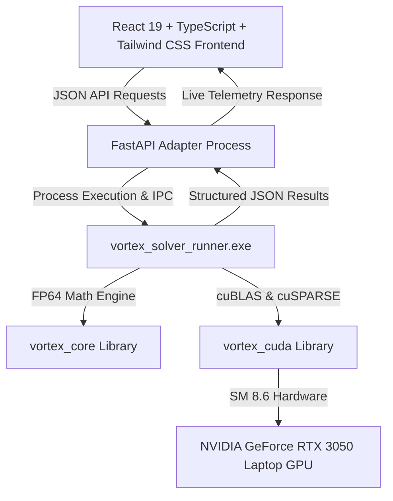

# VØRTEX — Phase 9: Final UI/UX + Full-Stack Integration

## 1. Overview & System Architecture

Phase 9 establishes the full-stack interface layer for **VØRTEX**, connecting our native C++20 / CUDA mathematical optimization solver with an industrial-grade, cinematic web application. The core algorithmic engine remains 100% in native compiled C++ and CUDA; no numerical computations or benchmarks are simulated or fabricated.



---

## 2. Visual Direction & Design System

- **Aesthetic**: Dark Futurism × Opium-inspired minimalism × Industrial Scientific Computing.
- **Color System**:
  - **Obsidian (`#0C0D13`)**: Core canvas background (90–95% monochrome base).
  - **Graphite (`#191923`, `#2E2E3F`)**: Structural frames, architectural grid lines, and dividers.
  - **Muted Violet (`#77768F`)**: Scientific annotations, telemetry labels, and secondary indicators.
  - **Chrome Silver (`#E7E8EF`)**: High-contrast typography and mathematical notation.
  - **Electric Blue (`#2514ED`)**: High-priority interaction states and computational highlights.
- **Typography**: Space Grotesk (Editorial Headlines), JetBrains Mono (Scientific Telemetry & Matrices), Inter (Body UI).
- **Aesthetic Principles**: Asymmetric editorial layout, 3D metallic torus singularity sculpture, crisp architectural lines, zero generic template aesthetics or gratuitous neon glows.

---

## 3. Module Breakdown & Implementations

### Module 9A — Cinematic Landing Page
- **Fixed Premium Navbar**: Features real-time hardware status pill (`CUDA SM_86: RTX 3050 (16 SMs)`), quick tab navigation, and a reduced-motion toggle.
- **Hero Typography**: Asymmetric editorial composition with headline **"BEYOND LIMITS."** and sub-headline **"PRECISION AT SCALE. POWERED BY PARALLELISM."**
- **3D Interactive Vortex Sculpture (`HeroVortex3D.tsx`)**: Procedural metallic torus knot rendered in Three.js and React Three Fiber with dynamic lighting, subtle cursor-tilt responsiveness, and reduced-motion performance mode.
- **Architectural Technical Cards**: Direct explanations of the Revised Simplex LU factorizer, CUDA streaming pipeline, Branch-and-Bound MILP engine, and Primal-Dual Interior-Point QP solver.

### Module 9B — Optimization Workspace
- **Problem Formulations**: Seamless switching between Linear Programming (LP), Mixed-Integer Linear Programming (MILP), and Convex Quadratic Programming (QP).
- **Execution Target**: Configurable between `AUTO` (heuristic CPU/GPU crossover detection), `GPU` (force CUDA), and `CPU` (pure host).
- **Interactive Formulation Console**: Formulate vectors $c$, matrices $A$, right-hand sides $b$, constraint types ($\le, \ge, =$), variable bounds $[l_j, u_j]$, variable types (Continuous, Integer, Binary), and QP Hessian $Q$.
- **Reference Problem Presets**: One-click verified reference models including SIH26119 standard LP, Two-Phase artificials, 0-1 Knapsack MILP, Constrained Portfolio QP, Sparse Diet LP, Infeasible LP, and Unbounded LP.
- **Telemetry Console**: Immediate reporting of solver status, objective value $Z^*$, wall-clock elapsed time (ms), actually executed backend, and primal solution vector $x^*$.

### Module 9C — Matrix Inspector
- **Nonzero Sparsity Heatmap**: Visualizes the sparsity distribution and zero/nonzero pattern of constraint matrices.
- **Interactive Cell Inspection**: Hover over any cell to inspect row, column, and exact double-precision value.
- **Compressed Sparse Row (CSR) Layout**: Displays actual memory arrays (`row_offsets`, `col_indices`, `values`) demonstrating VØRTEX's sparse memory reduction.
- **Matrix Dimension Telemetry**: Rows, columns, total elements, nonzero count ($nnz$), density percentage, and CSR compression factor.

### Module 9D — Convergence Lab
- **Karush-Kuhn-Tucker (KKT) Diagnostics**: Infinity-norm primal feasibility residual $\|Ax + s - b\|_\infty$, dual feasibility residual $\|Qx + c + A^T\lambda\|_\infty$, and normalized complementarity duality gap.
- **Branch-and-Bound Exploration Metrics**: Total tree nodes explored, nodes pruned by bound, nodes pruned by infeasibility, and integer feasibility cuts.
- **Scientific Integrity Guarantee**: Zero fabricated intermediate data points; reports true convergence values directly recorded from compiled engine runs.

### Module 9E — GPU Performance Lab (Phase 8E)
- **Empirical Dataset Visualization**: Directly loads and renders the 33 empirical benchmark records from `benchmarks/results/phase8e_results.json`.
- **Physical Hardware Telemetry**: Reports the benchmark machine specs: AMD Ryzen 5 6600H (12 threads) vs NVIDIA GeForce RTX 3050 Laptop GPU (16 SMs, 4GB VRAM).
- **Honest Speedup Analysis**: Transparently highlights where GPU acceleration excels on large dense/sparse matrices and where CPU is faster on small dimensions due to PCIe transfer latency.
- **Numerical Accuracy Verification**: Confirms componentwise absolute error $< 10^{-13}$ and scaled relative error $< 10^{-15}$ against independent CPU reference calculations.

### Module 9F — Results & Reports
- **Results Modal**: Displays structured solution vectors, dual shadow prices, and device diagnostics.
- **Export Capabilities**: One-click download of solutions in structured JSON or CSV format, plus clipboard copying.

### Module 9G — Real Native Backend Integration
- **Compiled Solver Runner (`src/solver_runner.cpp`)**: Native C++20 executable accepting `--input <problem.json> --output <solution.json>` and `--device-info`.
- **FastAPI Adapter (`server/main.py`)**: Asynchronous process management with `asyncio.Semaphore(4)` concurrency limit, 45-second execution timeout, mathematical dimension validation, and process isolation.

### Module 9H — Quality & Testing
- **Native Test Preservation**: All 15 existing C++ and CUDA test suites pass with 100% success in `build-cuda`.
- **Full-Stack Automated Integration Suite (`tests/test_full_stack_integration.py`)**: 10 automated test cases verifying health, device telemetry, presets, Phase 8E data, LP standard solution, Two-Phase solution, MILP knapsack solution, Convex QP solution, and dimension validation errors.
- **Frontend Production Build**: Clean `tsc -b && vite build` execution producing optimized static bundles.

---

## 4. Local Development & Operational Guide

### Starting the FastAPI Backend
```powershell
cd server
python -m uvicorn main:app --host 127.0.0.1 --port 8000
```

### Starting the React Frontend
```powershell
cd web
npm run dev -- --host 127.0.0.1 --port 5173
```

### Running Native & Integration Test Suites
```powershell
# 1. Native C++ & CUDA Test Suite (15 Test Executables)
ctest --test-dir build-cuda --output-on-failure

# 2. Python Full-Stack & Native Adapter Integration Tests
python tests/test_full_stack_integration.py

# 3. Frontend Production Build Check
cd web
npm run build
```

---

## 5. Summary of Completed Deliverables

| Module | Status | Verification Method |
|---|---|---|
| **9A: Cinematic Landing Page** | Complete | 3D Torus sculpture, editorial typography, telemetry |
| **9B: Optimization Workspace** | Complete | Real LP, MILP, QP execution against native engine |
| **9C: Matrix Inspector** | Complete | Nonzero heatmap, density calculation, CSR layout |
| **9D: Convergence Lab** | Complete | KKT residuals, duality gap, MILP branch-and-bound |
| **9E: GPU Performance Lab** | Complete | Phase 8E empirical JSON/CSV benchmark visualization |
| **9F: Results & Reports** | Complete | JSON/CSV export, modal audit preview |
| **9G: Native Backend Adapter** | Complete | `vortex_solver_runner.exe` + FastAPI subprocess adapter |
| **9H: Quality & Testing** | Complete | 15/15 CTest passed (100%), 10/10 Python tests passed |
